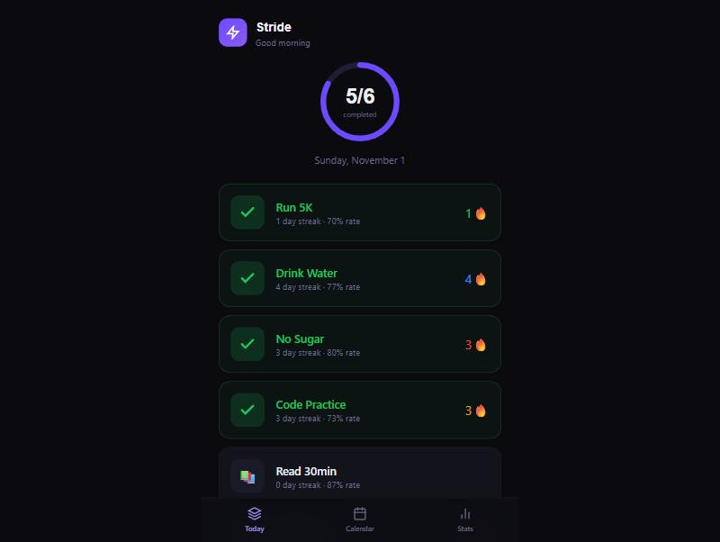

# Stride — Habit Tracker PWA

> Installable progressive web app for building and tracking daily habits, built by [Zolentix](https://zolentix.com)



## Features

- **Habit Tracking** — Create and manage daily habits with custom icons and colors
- **Streak Counter** — Track consecutive-day streaks with fire indicators
- **Progress Rings** — Visual completion rings for daily progress
- **Weekly Heatmap** — See your habit completion patterns at a glance
- **Motivational Stats** — Total completions, best streaks, and consistency scores
- **PWA** — Install on mobile for native app experience
- **Categories** — Organize habits by health, productivity, mindfulness, etc.

## Tech Stack

- **Framework:** Next.js 14 (App Router)
- **Language:** TypeScript
- **Styling:** Tailwind CSS
- **Database:** Prisma ORM + SQLite
- **PWA:** Web App Manifest
- **Fonts:** Space Grotesk + Inter

## Getting Started

```bash
npm install
npx prisma db push
npx prisma db seed
npm run dev
```

Open [http://localhost:3000](http://localhost:3000) to track your habits.

## License

MIT — [Zolentix](https://zolentix.com)
